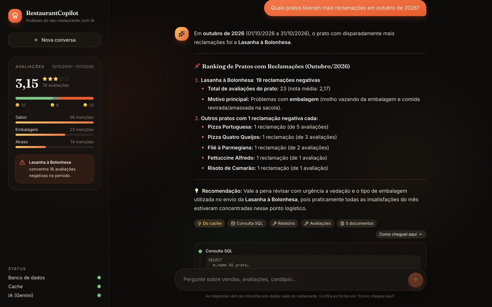
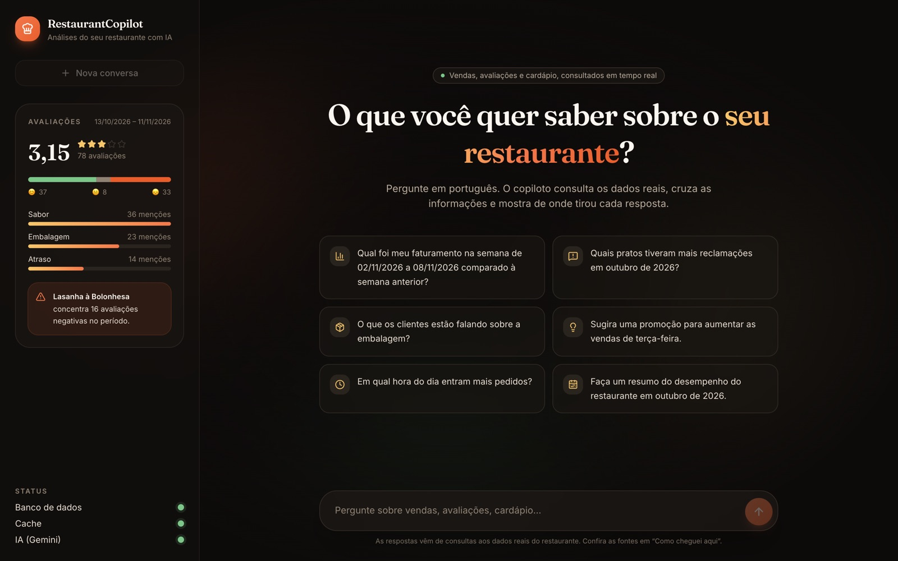
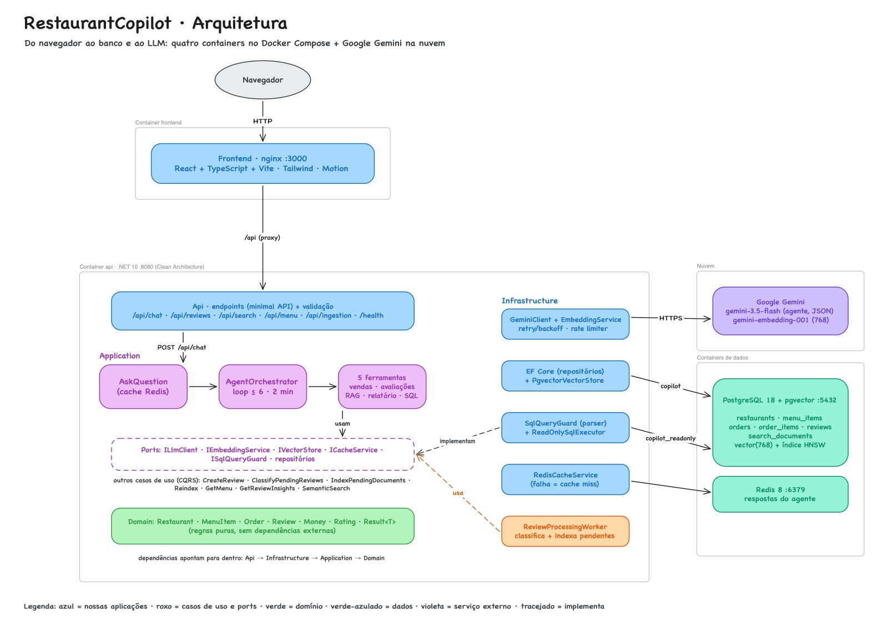

# RestaurantCopilot

[](https://github.com/LucassSantoss/restaurant-copilot/actions/workflows/ci.yml)
[](https://dotnet.microsoft.com/)
[](LICENSE)

**Um copiloto de IA que responde, em linguagem natural, perguntas de donos de restaurante sobre o próprio negócio, consultando os dados reais de cardápio, pedidos e avaliações.**

> **English summary:** RestaurantCopilot is an ASP.NET Core (.NET 10) API where restaurant owners ask natural-language questions about their business. An AI agent built on Google Gemini uses function calling over typed tools, RAG on PostgreSQL + pgvector and parser-guarded, read-only text-to-SQL to answer from real data, citing its sources. Reviews are classified with schema-constrained LLM output, answers are cached in Redis with version-based invalidation, and an evaluation runner grades the agent on a fixed question set. The codebase follows Clean Architecture (enforced by architecture tests), has 200+ unit and Testcontainers-based integration tests, and runs locally with a single `docker compose up`.



<details>
<summary>Tela inicial</summary>



</details>

---

## Problema

Donos de restaurantes pequenos e médios têm dados espalhados entre plataforma de delivery, sistema de pedidos e avaliações de clientes, mas raramente têm tempo ou conhecimento técnico para cruzá-los. Perguntas simples como *"quais pratos tiveram mais reclamações este mês?"* ou *"meu faturamento caiu em relação à semana passada?"* exigem planilhas, filtros e leitura manual de dezenas de comentários.

O RestaurantCopilot transforma essas perguntas em consultas aos dados reais e devolve uma resposta direta, **com as fontes que a embasaram**.

## Funcionalidades

- **Agente com ferramentas (function calling):** `POST /api/chat` recebe a pergunta; o LLM decide quais ferramentas usar (`search_sales`, `list_reviews`, `semantic_search`, `generate_report`, `query_database`), a aplicação as executa contra os dados reais e o modelo responde citando fontes e ferramentas.
- **Texto para SQL seguro:** para perguntas analíticas fora das ferramentas, o modelo escreve um `SELECT`, que passa por um guard com parser de PostgreSQL e roda com uma role **somente leitura**, em transação `READ ONLY`, com timeout e limite de linhas.
- **RAG:** cardápio e avaliações viram embeddings no PostgreSQL com **pgvector** (índice HNSW); a busca semântica encontra "a tampa abriu" quando a pergunta é sobre embalagem.
- **Processamento automático:** avaliações novas são classificadas e entram na busca semântica sozinhas, em segundos.
- **Análise de avaliações:** cada avaliação é classificada por **sentimento** e **temas** (atraso, sabor, embalagem, preço, atendimento) com saída JSON estruturada; `GET /api/reviews/insights` resume um período.
- **Cache de respostas** no Redis, invalidado automaticamente quando os dados mudam.
- **Avaliação do agente:** 26 perguntas com respostas conhecidas e um runner que mede a taxa de acerto.
- **Interface web** em React + TypeScript: chat com respostas em Markdown, "como cheguei aqui" (ferramentas, SQL, fontes e tokens) e um painel com o pulso das avaliações e o status das dependências.

| Método | Rota | Descrição |
|---|---|---|
| `POST` | `/api/chat` | Pergunta em linguagem natural ao agente (`Cache-Control: no-cache` ignora o cache) |
| `POST` | `/api/reviews` | Cadastra uma avaliação e a classifica com o LLM |
| `GET` | `/api/reviews/insights` | Sentimento, temas e pratos mais criticados por período |
| `GET` | `/api/menu` | Cardápio, com filtros por categoria e disponibilidade |
| `GET` | `/api/search` | Busca semântica (etapa de recuperação do RAG) |
| `POST` | `/api/ingestion/reindex` | Recria todos os embeddings do cardápio e das avaliações (reconstrução completa) |
| `POST` | `/api/ingestion/classify-reviews` | Classifica as avaliações pendentes, em lote |
| `GET` | `/health` | Estado do PostgreSQL, do Redis e do Gemini |

A documentação interativa (Scalar) fica em `/scalar` em ambiente de desenvolvimento.

## Arquitetura

O backend segue **Clean Architecture**: as dependências sempre apontam para dentro, e toda integração externa fica atrás de uma interface (port) definida pela camada de aplicação.

```
Api  →  Infrastructure  →  Application  →  Domain
```

| Camada | O que contém |
|---|---|
| `Domain` | Entidades (`Restaurant`, `MenuItem`, `Order`, `Review`), value objects (`Money`, `Rating`) e `Result<T>`. Sem dependências externas. |
| `Application` | Casos de uso (commands/queries com handlers próprios), o agente e suas ferramentas, e os ports: `ILlmClient`, `IEmbeddingService`, `IVectorStore`, `ICacheService`, `ISqlQueryGuard`, `IReadOnlySqlExecutor`, repositórios. |
| `Infrastructure` | Implementações: EF Core/PostgreSQL, pgvector, Redis, cliente Gemini, guard e executor de SQL. |
| `Api` | Endpoints (minimal APIs), composição da injeção de dependência, tratamento de erros, health checks. |

A regra não é só convenção: **testes de arquitetura** (`NetArchTest`) quebram o build se `Domain` ou `Application` dependerem de algo que não deveriam, incluindo EF Core, Npgsql, Redis ou ASP.NET Core ([ADR 0001](docs/adr/0001-clean-architecture.md)).

**Troca de provedor de LLM:** a aplicação depende só de `ILlmClient` e `IEmbeddingService`. O `GeminiClient` é uma implementação em `Infrastructure`; usar Groq, Ollama ou OpenAI significa escrever outra implementação e trocar o registro na injeção de dependência, **sem tocar em casos de uso, agente ou domínio** ([ADR 0004](docs/adr/0004-gemini-behind-llm-port.md)).

### Fluxo de uma pergunta (`POST /api/chat`)

1. A pergunta é validada e normalizada; se houver resposta em cache para ela, para o dia de hoje e para a versão atual dos dados, ela volta em milissegundos.
2. O `AgentOrchestrator` monta o prompt de sistema (data de hoje, fuso, período com dados, nomes do cardápio, regras) e envia a pergunta com as declarações das ferramentas ao Gemini.
3. Se o modelo pedir ferramentas, a aplicação valida os argumentos, executa (vendas, avaliações, busca semântica, relatórios ou SQL guardado) e devolve os resultados, em loop limitado a 6 turnos e 2 minutos.
4. Ferramenta inexistente ou argumento inválido viram uma mensagem de erro **para o modelo**, que se corrige no turno seguinte.
5. A resposta final volta com `sources` (ferramentas e documentos), `toolCalls` e uso de tokens, e é gravada no cache.



Versões em Mermaid (versionadas como texto) serão adicionadas em [`docs/diagrams/`](docs/diagrams/).

### Estrutura do repositório

```
├── backend/
│   ├── src/
│   │   ├── RestaurantCopilot.Domain/
│   │   ├── RestaurantCopilot.Application/
│   │   ├── RestaurantCopilot.Infrastructure/
│   │   └── RestaurantCopilot.Api/
│   ├── tests/                      # um projeto de testes por camada + avaliação
│   ├── tools/
│   │   └── RestaurantCopilot.Evaluation/   # runner da avaliação do agente
│   └── Dockerfile
├── docs/
│   ├── adr/                        # Architecture Decision Records
│   ├── diagrams/                   # diagramas Mermaid
│   └── evaluation.md               # metodologia e resultados da avaliação
├── evaluation/                     # perguntas e relatórios da avaliação
├── seed/                           # gerador e dados fictícios (JSON)
├── frontend/                       # interface de chat (React + TypeScript + Vite)
├── docker/postgres/initdb/         # cria o login somente leitura do texto para SQL
├── docker-compose.yml              # API + PostgreSQL (pgvector) + Redis
└── .github/workflows/ci.yml
```

## Stack

| Camada | Tecnologia | Por quê |
|---|---|---|
| API | .NET 10 (LTS), ASP.NET Core minimal APIs | Suporte de longo prazo, performance e tipagem forte |
| Arquitetura | Clean Architecture + CQRS leve | Isola regras de negócio de provedores que mudam ([ADR 0001](docs/adr/0001-clean-architecture.md)) |
| Casos de uso | Handlers próprios + Scrutor + FluentValidation | Sem dependência com licença comercial; validação como decorator ([ADR 0002](docs/adr/0002-own-cqrs-handlers.md)) |
| IA | Google Gemini (plano gratuito) via REST | Texto, JSON estruturado, function calling e embeddings sem custo ([ADR 0004](docs/adr/0004-gemini-behind-llm-port.md)) |
| Banco | PostgreSQL 18 + pgvector | Dados relacionais e vetoriais no mesmo banco, sem um serviço extra ([ADR 0006](docs/adr/0006-rag-with-pgvector.md)) |
| ORM | EF Core 10 + Npgsql, convenção snake_case | Migrations versionadas; nomes no padrão do PostgreSQL, legíveis também para o SQL gerado pelo LLM |
| Texto para SQL | SqlParserCS + role somente leitura | Validação por parser, não regex, com o banco como segunda barreira ([ADR 0008](docs/adr/0008-text-to-sql-defense-in-depth.md)) |
| Cache | Redis 8 | Respostas do agente com invalidação por versão ([ADR 0009](docs/adr/0009-chat-answer-cache.md)) |
| Resiliência | Microsoft.Extensions.Http.Resilience (Polly) | Retry com backoff para o `429` do plano gratuito, timeouts e circuit breaker |
| Logs | Serilog | Logs estruturados configuráveis por `appsettings`, com tokens e latência de cada chamada ao LLM |
| Documentação da API | OpenAPI + Scalar | Documento OpenAPI nativo do .NET com uma UI moderna |
| Testes | xUnit v3, Shouldly, NSubstitute, Testcontainers, NetArchTest | Integração contra PostgreSQL e Redis reais; regras de arquitetura verificadas |
| Frontend | React 19, TypeScript, Vite, Tailwind CSS 4, Motion | Interface rápida de construir e de navegar, com animações declarativas; nginx no Docker faz proxy da API |
| Infra local / CI | Docker Compose, GitHub Actions | Ambiente reproduzível com um comando; build, lint, testes e imagem Docker em todo push e PR |

## Como rodar

**Pré-requisitos:** Docker. Para desenvolver fora do container: .NET SDK 10.

```bash
cp .env.example .env          # coloque sua chave em GEMINI_API_KEY
docker compose up -d --build
```

- Interface web: http://localhost:3000
- API: http://localhost:8080 (`/health`, `/scalar` em desenvolvimento)

Na primeira subida, o PostgreSQL cria o login somente leitura (`docker/postgres/initdb`), e a API aplica as migrations e carrega os dados fictícios de [`seed/`](seed/) (só em banco vazio). Para recriar do zero: `docker compose down -v`.

As funcionalidades de IA precisam de uma chave do Gemini, gerada gratuitamente no [Google AI Studio](https://aistudio.google.com/apikey). Sem a chave, a API sobe normalmente, o `/health` mostra o Gemini como `Degraded` e os endpoints de IA respondem `503`. Os modelos são configuráveis (`Gemini__GenerationModel`, `Gemini__EmbeddingModel`); os padrões estão em [`appsettings.json`](backend/src/RestaurantCopilot.Api/appsettings.json).

Com a chave configurada, o processamento em segundo plano classifica as avaliações do seed e monta o índice semântico sozinho na primeira subida (~3 min; usa ~10 das 20 requisições diárias de geração do plano gratuito). Depois disso, é só perguntar:

```bash
curl -X POST http://localhost:8080/api/chat -H 'Content-Type: application/json' \
     -d '{"question": "Quais pratos tiveram mais reclamações em outubro de 2026?"}'
```

Os endpoints `POST /api/ingestion/classify-reviews` e `POST /api/ingestion/reindex` continuam disponíveis para forçar o processamento ou reconstruir o índice inteiro.

### Rodando a API localmente (sem container)

```bash
docker compose up -d postgres redis
dotnet user-secrets set "Gemini:ApiKey" "<sua-chave>" --project backend/src/RestaurantCopilot.Api
dotnet run --project backend/src/RestaurantCopilot.Api
```

- API: http://localhost:5080
- Documentação interativa (Scalar): http://localhost:5080/scalar
- OpenAPI: http://localhost:5080/openapi/v1.json

Para o frontend em modo de desenvolvimento (com recarga automática), com a API rodando: `cd frontend && npm install && npm run dev` → http://localhost:5173 (encaminha `/api` para a porta 8080; veja [`frontend/README.md`](frontend/README.md)).

## Exemplos de requisições

### Pergunta ao agente

```http
POST /api/chat
Content-Type: application/json

{ "question": "Qual foi meu faturamento na última semana comparado à anterior?" }
```

```json
{
  "answer": "Na última semana (02/11 a 08/11/2026) você faturou R$ 13.143,60 em 123 pedidos, contra R$ 12.889,90 em 105 pedidos na semana anterior (26/10 a 01/11): alta de 2,0%. ...",
  "sources": [
    { "kind": "tool", "reference": "search_sales", "description": "Vendas de 02/11/2026 a 08/11/2026" },
    { "kind": "tool", "reference": "search_sales", "description": "Vendas de 26/10/2026 a 01/11/2026" }
  ],
  "toolCalls": [
    { "tool": "search_sales", "arguments": { "period_start": "2026-11-02", "period_end": "2026-11-08" }, "succeeded": true, "error": null },
    { "tool": "search_sales", "arguments": { "period_start": "2026-10-26", "period_end": "2026-11-01" }, "succeeded": true, "error": null }
  ],
  "usage": { "inputTokens": 4210, "outputTokens": 180 },
  "cached": false
}
```

> Os números são os do seed; a redação da resposta e o uso de tokens variam conforme o modelo.

### Cadastro e análise de avaliações

```http
POST /api/reviews
Content-Type: application/json

{ "orderNumber": 1001, "rating": 1, "comment": "A lasanha chegou toda vazada, molho espalhado na sacola." }
```

```json
{
  "id": "019a7c3e-5d1b-7a20-9b4e-2f1c8d6e4a10",
  "orderNumber": 1001,
  "menuItemId": null,
  "rating": 1,
  "comment": "A lasanha chegou toda vazada, molho espalhado na sacola.",
  "createdAt": "2026-11-11T18:20:00+00:00",
  "classification": { "sentiment": "Negative", "themes": ["Packaging"] }
}
```

Se o Gemini estiver indisponível, a avaliação é salva com `"classification": null` e o processamento em segundo plano a classifica (e indexa para a busca semântica) assim que o Gemini voltar.

```http
GET /api/reviews/insights?from=2026-10-01&to=2026-10-31
```

```json
{
  "from": "2026-10-01",
  "to": "2026-10-31",
  "totalReviews": 90,
  "classifiedReviews": 90,
  "averageRating": 3.22,
  "sentiment": { "positive": 40, "neutral": 9, "negative": 41 },
  "themes": [
    { "theme": "Packaging", "mentions": 31, "negative": 29 },
    { "theme": "Taste", "mentions": 30, "negative": 6 }
  ],
  "mostComplainedDishes": [
    { "menuItemId": "019a7c3e-...", "name": "Lasanha à Bolonhesa", "negativeReviews": 19 }
  ]
}
```

> Total, média e pratos vêm do seed; as contagens de sentimento e temas são ilustrativas, porque dependem da classificação feita pelo modelo.

### Busca semântica

```http
GET /api/search?query=problemas com a embalagem&source=Review&limit=2
```

```json
[
  {
    "source": "Review",
    "sourceId": "019a7c3e-...",
    "content": "Avaliação de cliente, nota 1/5, em quarta-feira, 28/10/2026, sobre o pedido: \"Embalagem frágil, a tampa abriu no caminho e sujou tudo.\"",
    "similarity": 0.81
  }
]
```

### Cardápio e health check

```http
GET /api/menu?category=Dessert
```

```json
[
  {
    "id": "01a1cd1d-f94b-7901-9967-a09832d37846",
    "name": "Cannoli Siciliano",
    "description": "Massa crocante recheada com ricota doce (2 unidades).",
    "category": "Dessert",
    "price": 26.90,
    "isAvailable": true
  }
]
```

```json
{
  "status": "Healthy",
  "durationMs": 71.5,
  "checks": {
    "postgres": { "status": "Healthy", "description": null, "durationMs": 69.9 },
    "redis": { "status": "Healthy", "description": null, "durationMs": 49.1 },
    "gemini": { "status": "Healthy", "description": "Model gemini-3.5-flash is reachable.", "durationMs": 180.2 }
  }
}
```

Erros seguem o [Problem Details (RFC 9457)](https://www.rfc-editor.org/rfc/rfc9457): `400` para validação (com os erros de cada campo), `404` para recurso inexistente, `503` quando o LLM está indisponível, sem chave ou no limite do plano gratuito. O `/health` responde `503` se o PostgreSQL ou o Redis estiverem fora do ar; problemas no Gemini deixam o status `Degraded` (HTTP 200), porque o resto da API continua funcionando.

## Testes e CI

```bash
cd backend
dotnet test                         # precisa do Docker (Testcontainers)
dotnet format --verify-no-changes   # mesmo lint do CI
```

Os testes rodam na **Microsoft.Testing.Platform** com xUnit v3. Os de integração sobem PostgreSQL (imagem pgvector, com o mesmo script de init do Compose) e Redis reais com **Testcontainers**. **Nenhum teste chama o Gemini**: o LLM é substituído por dublês roteirizados ou por um `HttpMessageHandler` falso.

| Projeto | Cobre |
|---|---|
| `RestaurantCopilot.Domain.Tests` | Invariantes das entidades e value objects (`Money`, `Rating`, `Order`, `Review`, classificação) |
| `RestaurantCopilot.Application.Tests` | Todos os casos de uso; o loop do agente (ferramentas, ferramenta inexistente, limite de iterações, timeout); schemas das ferramentas; agregações de vendas e insights no fuso do restaurante; cache e invalidação |
| `RestaurantCopilot.Infrastructure.Tests` | Repositórios, mapeamentos do EF Core, seed e busca vetorial contra PostgreSQL real; guard de SQL (dezenas de tentativas de escrita, injeção e acesso a catálogos); executor somente leitura, que bloqueia escrita, tabelas fora da permissão e consultas longas **mesmo sem o guard**; cliente Gemini (formato das requisições, function calling, erros, retry de `429`); cache Redis, incluindo Redis fora do ar |
| `RestaurantCopilot.Api.Tests` | Regras de dependência entre camadas e endpoints de ponta a ponta: chat com ferramentas rodando contra dados reais, texto para SQL bloqueando `DELETE`, cache e invalidação, reindex + busca semântica, validação e health checks |
| `RestaurantCopilot.Evaluation.Tests` | Corretores da avaliação (extração de números em pt-BR/en, palavras-chave) e integridade do conjunto de perguntas |

O [workflow de CI](.github/workflows/ci.yml) roda em todo push na `main` e em pull requests: restore, `dotnet format --verify-no-changes`, build em Release com warnings tratados como erros, todos os testes e o build da imagem Docker.

## Resultados da avaliação do agente

O agente é avaliado com **26 perguntas** sobre os dados do seed: vendas, texto para SQL, avaliações, conselhos e segurança. Respostas numéricas são corrigidas por match exato; as abertas, por palavras-chave ou um LLM como juiz com critérios explícitos. Metodologia completa e como rodar em [`docs/evaluation.md`](docs/evaluation.md).

A avaliação **não roda automaticamente** (gasta cota real do LLM). Por padrão, `dotnet run --project backend/tools/RestaurantCopilot.Evaluation` executa a suíte rápida **`smoke`** (4 perguntas, ~8 chamadas), que cabe na cota gratuita diária do Gemini; `--suite full` roda as 26.

| Suíte | Resultado |
|---|---|
| `smoke` (4 perguntas: vendas, texto para SQL, avaliações) | **4/4 corretas**: 3/4 na primeira execução (uma pergunta estourou o tempo limite por lentidão do Gemini) e 1/1 ao repetir ([detalhes](docs/evaluation.md#resultados)) |
| `full` (26 perguntas) | pendente: precisa ser dividida em vários dias por causa da cota gratuita |

## Decisões técnicas e trade-offs

- **Limites do plano gratuito do Gemini:** retry exponencial com jitter (respeitando `Retry-After`), timeout por tentativa e total, classificação em lotes de 25 e embeddings ritmados por um rate limiter (o plano gratuito conta cada texto como uma requisição, 100 por minuto). Quando as tentativas acabam, o erro é explícito (`Llm.RateLimited`, HTTP 503), nunca um 500. Atenção: no momento, o `gemini-3.5-flash` gratuito permite só **20 requisições por dia**; cada pergunta ao agente usa de 2 a 4, por isso o cache faz diferença.
- **Cache que não serve resposta velha:** a chave inclui a data de hoje no fuso do restaurante e uma versão dos dados, trocada a cada nova avaliação, classificação ou reindex. Se o Redis cair, o cache vira *miss* em vez de erro ([ADR 0009](docs/adr/0009-chat-answer-cache.md)).
- **Texto para SQL em três camadas:** guard com parser de PostgreSQL (um único `SELECT`, sem comentários, sem palavras de escrita em lugar nenhum, sem catálogos), role do banco que só lê as tabelas de negócio e transação `READ ONLY` com timeout e limite de linhas. Cada camada sozinha já impede escrita ([ADR 0008](docs/adr/0008-text-to-sql-defense-in-depth.md)).
- **Agente limitado e tolerante a erros:** no máximo 6 turnos com ferramentas (depois, uma resposta forçada sem ferramentas), timeout total, e erros de ferramenta devolvidos ao modelo para que ele se corrija ([ADR 0007](docs/adr/0007-agent-function-calling.md)).
- **Números vêm de ferramentas, não do modelo:** as agregações são C# determinístico e testado; o prompt proíbe inventar dados; cada resposta traz as ferramentas e documentos usados.
- **Schemas gerados a partir de tipos:** argumentos de ferramentas e saídas estruturadas (classificação, juiz) são records C#; o JSON Schema enviado ao modelo é derivado deles, então declaração e parsing nunca divergem.
- **Prompt injection:** avaliações de clientes e resultados de ferramentas são tratados como dados; o classificador não tem ferramentas, e o agente só tem acesso de leitura. No pior caso, uma avaliação é mal classificada.
- **Classificação que não perde dados:** se o LLM falhar ao cadastrar uma avaliação, ela é salva como pendente e classificada depois, em lote ([ADR 0005](docs/adr/0005-review-classification.md)).
- **Avaliações processadas em segundo plano:** ao cadastrar uma avaliação, um worker a classifica e a adiciona à busca semântica em segundos, só com o que está pendente (indexação incremental). Pendências ficam no banco, então nada se perde se a API reiniciar ou o Gemini cair; falhas esperam cada vez mais, até 15 min ([ADR 0010](docs/adr/0010-background-review-processing.md)).
- **RAG sem serviço extra:** vetores no próprio PostgreSQL (pgvector + HNSW), documentos autocontidos em português, reindex atômico e checagem de dimensão antes de gastar cota ([ADR 0006](docs/adr/0006-rag-with-pgvector.md)).
- **Fuso horário como regra de negócio:** "terça-feira" e "outubro" são do restaurante (São Paulo), não do UTC; todas as agregações e o texto para SQL convertem as datas.
- **Seed determinístico e versionado** ([ADR 0003](docs/adr/0003-deterministic-seed-data.md)): os mesmos dados alimentam demo, testes e avaliação; padrões plantados dão ao agente algo real a descobrir; todo registro passa pelas regras do domínio.
- **Erros de negócio como valores:** factories e casos de uso retornam `Result<T>`; a API traduz o tipo do erro em status HTTP com Problem Details. Exceções ficam para o que é realmente excepcional.
- **Qualidade no build:** analyzers `latest-recommended`, warnings como erros, `.editorconfig` verificado no CI, versões de pacotes centralizadas e imagem Docker sem root.
- **Um restaurante só, sem autenticação:** simplifica o MVP; multi-tenant e autenticação estão nos próximos passos.

As decisões completas estão nos [ADRs](docs/adr/).

## Próximos passos

- Executar e publicar a avaliação do agente; rodá-la periodicamente no CI com uma chave dedicada.
- Diagramas de arquitetura e de fluxo em Mermaid ([`docs/diagrams/`](docs/diagrams/)).
- Autenticação (JWT) e suporte a vários restaurantes, com isolamento por tenant também no texto para SQL (row-level security).
- Respostas em streaming (Server-Sent Events) no `/api/chat`.
- Observabilidade com OpenTelemetry (traces por chamada ao LLM e por ferramenta).

## Licença

[MIT](LICENSE)
